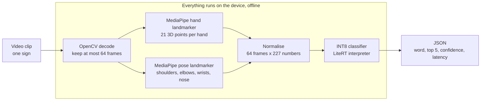
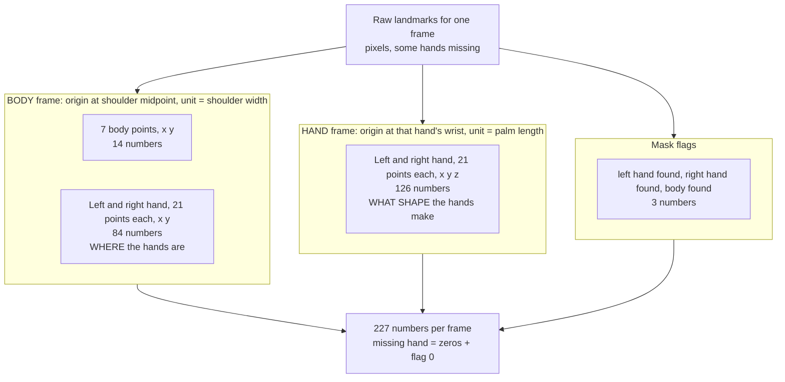
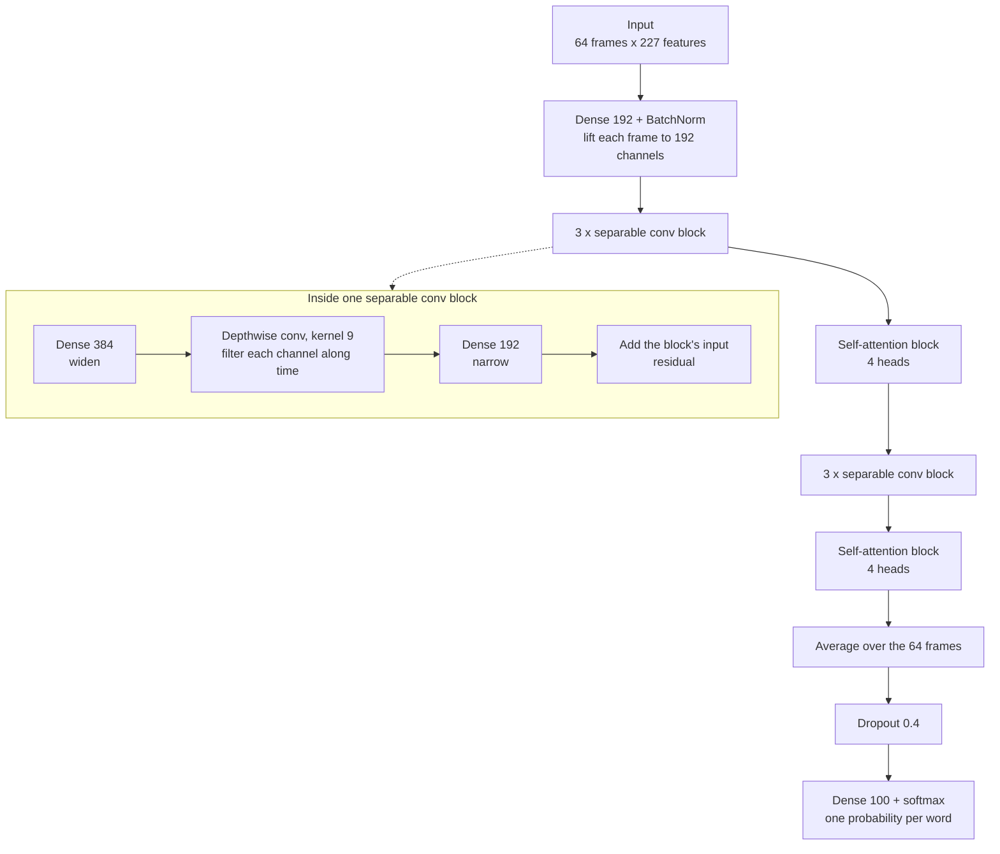
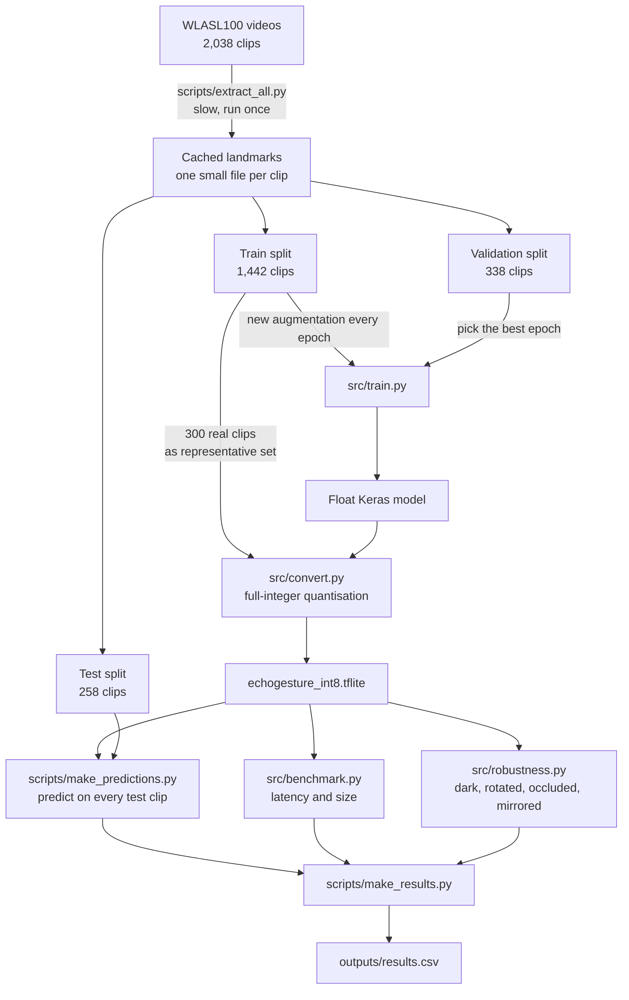
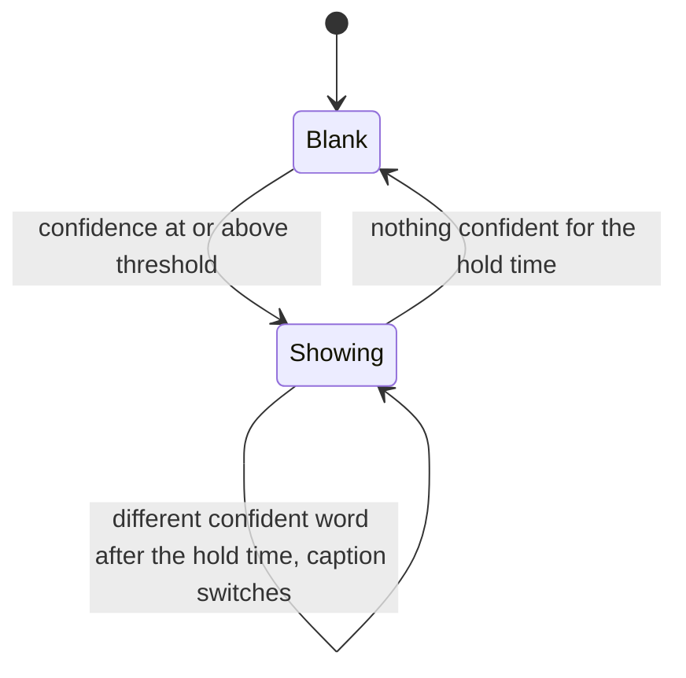

# EchoGesture

**On-device isolated sign recognition: one short clip of one sign in, one English word out.**
Entry for Track 2 of the Samsung PRISM XR Hackathon 2026.

A hearing person who does not sign cannot follow a Deaf signer without an interpreter.
EchoGesture is the recognition building block for a wearable or phone that shows captions
to the wearer: it watches a sign and names the word, entirely on the device.

- **Private:** the video is reduced to keypoints on the device; no image is stored or sent.
- **Small:** one INT8 classifier plus two MediaPipe models, measured against a 20 MB budget.
- **Honest:** every number here is written by a script in this repo. Anything we could not measure says "not measured".

**What it is not:** it does not translate continuous, conversational signing, and it only
knows the 100 ASL words in [`configs/vocab.txt`](configs/vocab.txt).

## Contents

- [How it works](#how-it-works)
- [Results](#results)
- [Setup](#setup)
- [Recognise a clip](#recognise-a-clip)
- [Live webcam demo](#live-webcam-demo)
- [For teammates: get the data and train](#for-teammates-get-the-data-and-train)
- [Reproduce every number](#reproduce-every-number)
- [Design choices](#design-choices)
- [Repository layout](#repository-layout)
- [Vocabulary assumption](#vocabulary-assumption)
- [AI assistance](#ai-assistance)

## How it works

### The pipeline

The video is turned into keypoints first, and only the keypoints are classified.



| Stage | Module | What comes out |
|---|---|---|
| Decode | [`src/landmarks.py`](src/landmarks.py) | Up to 64 evenly spaced frames |
| Landmarks | [`src/landmarks.py`](src/landmarks.py) | Raw hand and body points in pixels; "not found" is recorded, not guessed |
| Normalise | [`src/normalize.py`](src/normalize.py) | A fixed 64 x 227 table, every value in [-3, 3] |
| Classify | [`src/classifier.py`](src/classifier.py) | A probability for each of the 100 words |
| Report | [`predict.py`](predict.py) | The JSON the evaluator reads |

### What the model actually sees

Each of the 64 frames becomes 227 numbers. The hands appear twice, in two different
coordinate frames, because a sign is defined both by **where** the hand is and by **what
shape** it makes.



- **Body frame** removes where the signer stands and how far they are from the camera.
- **Hand frame** removes the hand's position and size, leaving handshape and orientation. This is the pose-invariant 3D hand feature the brief asks for.
- **Mask flags** make "hand not visible" a state the model has been trained on, instead of garbage coordinates.

### The classifier

About 1.59 million parameters (1,586,596). Convolutions read local motion over a few
frames; attention relates distant moments of the sign to each other.



Defined in [`src/model.py`](src/model.py). `python -m src.train --arch conv` trains the
same network without the attention blocks, which is the fallback if attention had failed
to convert to INT8. It converted cleanly, so the fallback is not used.

### From dataset to shipped model



The test split is used only to report the final number. It never influences training or
the choice of model.

### Live captions

In the webcam demo a word is shown only when the model is confident, and then held, so
the caption does not flicker between guesses.



Defaults: threshold 0.6, hold 1.5 s, in [`src/config.py`](src/config.py).

## Results

<!-- RESULTS:START -->
### Organisers' results table (`outputs/results.csv`)

| Metric | Target | Measured | Pass |
|---|---|---|---|
| `top1_accuracy` | >= 70 % | 82.56 % | PASS |
| `latency_p95` | <= 50 ms | 3407.89 ms | FAIL |
| `model_size` | <= 25 MB | 15.42 MB | PASS |
| `accuracy_drop_robustness` | <= 5 points | 11.92 points | FAIL |
| `avg_power` | <= 500 mW | not measured | not measured |
| `thermal_drift_10min` | <= 20 % | not measured | not measured |

Notes per row:

- `top1_accuracy`: INT8 model via predict() on all 258 clips of the WLASL100 test split; top-5 = 93.41 %
- `latency_p95`: value = whole clip incl. landmarks (config.LATENCY_METRIC_FOR_RESULTS). All p95 over 200 runs: classifier call 2.38 ms; landmarks per frame 66.61 ms; whole clip 3407.89 ms (55 frames). Device: 12th Gen Intel(R) Core(TM) i7-12650H, LiteRT (ai-edge-litert 2.3.0), CPU, XNNPACK delegate
- `model_size`: sum of every model file loaded (classifier_int8 1.82; mediapipe_hand_landmarker 7.82; mediapipe_pose_landmarker_lite 5.78); pass is judged against our stricter 20 MB design budget
- `accuracy_drop_robustness`: clean 82.56 % minus mean of perturbed sets 70.64 % (dark 80.23 %; rotated 82.17 %; occluded 37.60 %; mirrored 82.56 %); 258 test clips each
- `avg_power`: needs an on-phone run (Android stretch goal not built); not estimated
- `thermal_drift_10min`: needs an on-phone run (Android stretch goal not built); not estimated

### Accuracy: float model against INT8 (`outputs/quantization.json`)

Measured on cached landmarks of the official WLASL100 splits. Every clip in the split counts, including clips where no hand was found.

| Split | Clips | Float top-1 | INT8 top-1 | Float top-5 | INT8 top-5 | Same top word |
|---|---|---|---|---|---|---|
| val | 338 | 85.21 % | 85.21 % | 94.97 % | 94.38 % | 99.11 % |
| test | 258 | 83.33 % | 82.56 % | 93.80 % | 93.41 % | 98.84 % |

- Parameters: 1,586,596
- Float model file: 19.31 MB; INT8 model file: 1.82 MB
- Float tensors left in the INT8 model: 0 (0 means fully integer)
- Representative set: 300 training clips
- Training: 1441 clips, best validation epoch 190 of 250 run, 38 minutes on CPU

### Latency (`outputs/benchmark.json`)

Device: 12th Gen Intel(R) Core(TM) i7-12650H, Windows-10-10.0.26300-SP0. Runtime: LiteRT (ai-edge-litert 2.3.0), CPU, XNNPACK delegate, 1 thread for the classifier. 200 timed runs after 10 warm-up runs, over 20 test clips (median 55 frames per clip).

| Measurement | p50 (ms) | p95 (ms) | max (ms) |
|---|---|---|---|
| One classifier call (isolated) | 2.36 | 2.38 | 2.40 |
| Stage: decode video | 21.04 | 36.82 | 63.66 |
| Stage: landmarks, whole clip | 2846.03 | 3378.49 | 3893.59 |
| Stage: normalise | 0.88 | 1.46 | 1.75 |
| Stage: classifier | 4.29 | 6.07 | 7.08 |
| Landmarks per frame | 52.89 | 66.61 | 80.59 |
| **End to end, one clip** | 2869.72 | 3407.89 | 3920.76 |

The brief does not say whether its 50 ms ceiling means one classifier call, one frame, or a whole clip, so all three are reported. This is a laptop CPU, not a phone.

### Model size

| File | Size (MB) |
|---|---|
| classifier_int8 | 1.82 |
| mediapipe_hand_landmarker | 7.82 |
| mediapipe_pose_landmarker_lite | 5.78 |
| **Total** | **15.42** |

Budget 20 MB: within budget. MB = 1,000,000 bytes.

### Robustness (`outputs/robustness.json`)

The pixels of all 258 test clips are damaged, MediaPipe is re-run, and the INT8 model classifies the result.

| Test set | Top-1 | Top-5 | Drop in top-1 (points) |
|---|---|---|---|
| Clean | 82.56 % | 93.41 % | |
| Dark (brightness x0.25) | 80.23 % | 89.92 % | 2.33 |
| Rotated (15 degrees) | 82.17 % | 92.64 % | 0.39 |
| Occluded (box over 35% x 35% of the frame) | 37.60 % | 53.10 % | 44.96 |
| Mirrored (left-right flip) | 82.56 % | 94.19 % | 0.00 |
| **Mean of the four** | **70.64 %** | | **11.92** |

### Confusion analysis (`outputs/confusion.csv`, `outputs/confusion.json`)

45 of 258 test clips are wrong, spread over 43 different word pairs. 65 of the 100 words are never wrong.

Word pairs confused more than once (either direction):

| Pair | A read as B | B read as A | Total |
|---|---|---|---|
| dog / later | 1 | 1 | 2 |
| no / right | 1 | 1 | 2 |

Weakest words (correct / test clips): right 0/2; school 0/2; before 1/4; fine 1/3; letter 1/3; pizza 1/3.

Most frequent wrong guesses: fish (3); but (2); drink (2); last (2); letter (2).

With 2 to 4 test clips per word, each pair rests on one or two clips. Pairs seen only once are listed in `confusion.csv` in alphabetical order; their order there is not a ranking.

### Not measured

`avg_power` and `thermal_drift_10min` need a run on a phone. There is no Android build (it is a stretch goal), so they are reported as not measured, never estimated.
<!-- RESULTS:END -->

The block above is written by [`scripts/update_readme.py`](scripts/update_readme.py) from
the files in [`outputs/`](outputs/). It is never edited by hand.

## Setup

Python **3.11** is required (Keras 3.15 does not support 3.10). Tested on Windows 11. CPU
only; no GPU is needed.

```
python -m venv .venv
.venv\Scripts\activate            # Linux/macOS: source .venv/bin/activate
pip install -r requirements.txt
python scripts/get_mediapipe_models.py
```

The last line downloads the two MediaPipe model files (7.82 MB and 5.78 MB) into
`models/mediapipe/`. Together with the dataset download, it is the only step that needs
the network; recognition itself runs offline.

Check the install:

```
python -m pytest -q
```

## Recognise a clip

```
python predict.py path/to/clip.mp4
```

or from Python:

```python
from predict import predict
result = predict("path/to/clip.mp4")
```

Output format (defined in one function, `format_output()` in [`predict.py`](predict.py)):

```json
{
  "clip_id": "clip",
  "prediction": "book",
  "confidence": 0.83,
  "top5": [{"word": "book", "confidence": 0.83}, {"word": "...", "confidence": 0.05}],
  "latency_ms": {"decode": 0.0, "landmarks": 0.0, "normalize": 0.0, "classifier": 0.0, "total": 0.0},
  "frames": 64
}
```

The values above only illustrate the format; they are not measurements.

## Live webcam demo

```
python demo/live.py                    # press q to quit
python demo/live.py --mirror           # show the picture mirrored, like a selfie camera
python demo/live.py --source clip.mp4  # run a video file through the same loop
python demo/live.py --source clip.mp4 --no-window   # no display, prints caption changes
python demo/live.py --no-speak        # captions on screen only, no voice
```

Each new caption is spoken aloud by Windows' built-in offline voice (System.Speech), through
[`demo/speech.py`](demo/speech.py). It needs no extra package and no network. The voice runs in a
separate process, so the video never waits for it, and a new caption interrupts the previous word
instead of queueing behind it. On Linux and macOS the demo runs silently. `--no-window` runs never
speak.

## For teammates: get the data and train

There are two kinds of data, and you can get either without the other.

| You want to | You need | How to get it |
|---|---|---|
| Train or convert the model | Cached landmarks (80.7 MB zip) | Ask the teammate who ran extraction for `echogesture_wlasl100_landmarks.zip`, then unpack it (below). Or build it yourself from the videos. |
| Run predictions, benchmark, robustness, or re-extract landmarks | The WLASL100 videos (about 212 MB) | `python scripts/get_wlasl100.py` |

**Fastest route to training (no videos, no hour of extraction):**

```
python scripts/pack_landmarks.py --unpack path\to\echogesture_wlasl100_landmarks.zip
python -m src.train
python -m src.convert
```

**Building the landmarks yourself from the public videos:**

```
python scripts/get_wlasl100.py     # downloads the json and 2,038 clips into data/wlasl/
python scripts/extract_all.py      # about an hour on a laptop; resumable
python scripts/pack_landmarks.py   # optional: make the zip to pass on
```

The zip is not in this repository: it is too large for git, and the dataset licence
(WLASL, C-UDA: computational use only) means it should be shared inside the team, not
posted publicly. Whoever has it can send it over Drive or a USB stick; it lives at
`data/share/echogesture_wlasl100_landmarks.zip` on the machine that built it.

Watch a long run from another terminal (PowerShell):

```
Get-Content logs\train.log -Wait -Tail 5
```

if you started it with `python -m src.train *> logs\train.log`.

## Reproduce every number

Everything, in one command (downloads the data, extracts, trains, converts, measures):

```
python scripts/run_all.py
```

Or step by step:

| Step | Command | Writes |
|---|---|---|
| MediaPipe models | `python scripts/get_mediapipe_models.py` | `models/mediapipe/` |
| Dataset | `python scripts/get_wlasl100.py` | `data/wlasl/` |
| Cache landmarks | `python scripts/extract_all.py` | `data/landmarks/`, `data/manifest.csv`, `outputs/extraction_report.md`, `outputs/clip_counts.csv` |
| Train | `python -m src.train` | `models/echogesture_float.keras`, `outputs/train_log.json` |
| Convert to INT8 | `python -m src.convert` | `models/echogesture_int8.tflite`, `outputs/quantization.json` |
| Predictions | `python scripts/make_predictions.py --workers 3` | `outputs/predictions.jsonl` |
| Confusion pairs | `python scripts/confusion.py` | `outputs/confusion.csv`, `outputs/confusion.json` |
| Latency and size | `python -m src.benchmark` | `outputs/benchmark.json` |
| Robustness | `python -m src.robustness` | `outputs/robustness.json` |
| Results table | `python scripts/make_results.py` | `outputs/results.csv` |
| README results block | `python scripts/update_readme.py` | the Results section above |
| Tests | `python -m pytest -q` | |

Useful options:

- `python scripts/run_all.py --from train` starts at a later step; `--only benchmark` runs one step.
- `python -m src.benchmark --runs 20` and `python -m src.robustness --limit 20` are quick checks.
- Run the benchmark with nothing else running, or the latency will be inflated.

### Retrain on another word list

Edit [`configs/vocab.txt`](configs/vocab.txt) (one word per line; each must be a gloss in
the WLASL json), then run `python scripts/run_all.py --from extract`. The number of
classes is read from that file; nothing else names the vocabulary. To regenerate the file
from the first N glosses of the json: `python scripts/extract_all.py --write-vocab 100`.

## Design choices

| Choice | Instead of | Why |
|---|---|---|
| Classify keypoints | A video model on pixels | A keypoint classifier is a couple of megabytes and never stores an image. A video model has a higher accuracy ceiling but would not fit the size and latency budgets comfortably. |
| MediaPipe as shipped | Training our own detector | It runs on-device, gives 3D hand points, and five days is not enough to train a detector. |
| At most 64 frames reach MediaPipe | Every frame | The classifier reads exactly 64 frames, so landmarking more is latency with no benefit. |
| Hands matched to the pose skeleton's wrists | Trusting MediaPipe's left/right label | The label is guessed from the hand crop and flips when hands cross; the skeleton sees the whole arm. |
| Hands in two frames (body and hand) | One set of coordinates | Location and handshape are separate cues, and each needs its own normalisation. |
| Zeros plus a mask flag for a missing hand | Interpolating or leaving noise | Occlusion becomes something the model has seen in training. |
| One body centre and scale per clip | Per-frame | A signer does not move within a two-second sign; per-frame values would add shoulder jitter to every hand coordinate. |
| Separable convolutions plus two attention blocks | A plain transformer or LSTM | Small, fast, and all of it converts to integer operations. |
| BatchNorm and ReLU | LayerNorm and GELU | These fold into neighbouring layers and quantise cleanly to INT8. |
| Augment the keypoints, fresh every epoch | Augmenting video | Thousands of times cheaper, which matters with about 14 training clips per word. |
| Full-integer INT8, post-training | Float16 or dynamic-range | It is what integer-only edge accelerators run, and what the brief scores. |
| Robustness tested on damaged pixels | Damaged keypoints | The test then includes MediaPipe itself failing, which is what happens in bad light. |
| Threshold plus hold time for captions | Showing every prediction | A caption that flickers is unreadable. |

Each module's reasoning is written out in plain language in
[`docs/MODULES.md`](docs/MODULES.md). Decisions taken where the brief was unclear are
logged in [`docs/ASSUMPTIONS.md`](docs/ASSUMPTIONS.md).

## Repository layout

```
predict.py              the function the evaluator runs
configs/vocab.txt       the word list (the only place it is defined)
src/
  config.py             paths and constants
  landmarks.py          video -> keypoints (MediaPipe)
  normalize.py          centring, scaling, masking -> 64 x 227 features
  augment.py            training-time augmentation
  model.py              network definition
  train.py              training loop
  convert.py            Keras -> full-integer INT8 TFLite
  classifier.py         runs the INT8 model (input scaling lives here)
  benchmark.py          latency and size
  robustness.py         perturbed test set and accuracy drop
  data.py               manifest and cache readers
scripts/
  get_mediapipe_models.py   download the two MediaPipe models
  get_wlasl100.py           download the dataset
  extract_all.py            cache landmarks for the dataset
  pack_landmarks.py         zip / unzip the cached landmarks for teammates
  make_predictions.py       writes predictions.jsonl
  confusion.py              the word pairs the model mixes up
  make_results.py           writes results.csv
  update_readme.py          writes the Results block of this file
  run_all.py                all of the above in order
demo/live.py            webcam captions
demo/speech.py          speaks each caption, offline
models/                 echogesture_int8.tflite and the float model it was converted from
outputs/                predictions.jsonl, results.csv and the json files behind them
docs/                   STATUS.md, MODULES.md, ASSUMPTIONS.md
tests/
```

## Vocabulary assumption

The organisers have not supplied a word list, so we assume **WLASL100**: the first 100
glosses of `WLASL_v0.3.json`, with the **official train / val / test split** stored in
that file (1,442 / 338 / 258 clips). The model is trained on train, selected on val and
reported on test. Of the 2,038 clips, 2,036 were usable (a hand was found in at least one
frame); see [`outputs/extraction_report.md`](outputs/extraction_report.md).

## AI assistance

An AI coding assistant was used for code generation in this project, under the team's
direction. Each module has an owner on the team who ran it, tested it and can explain it.
